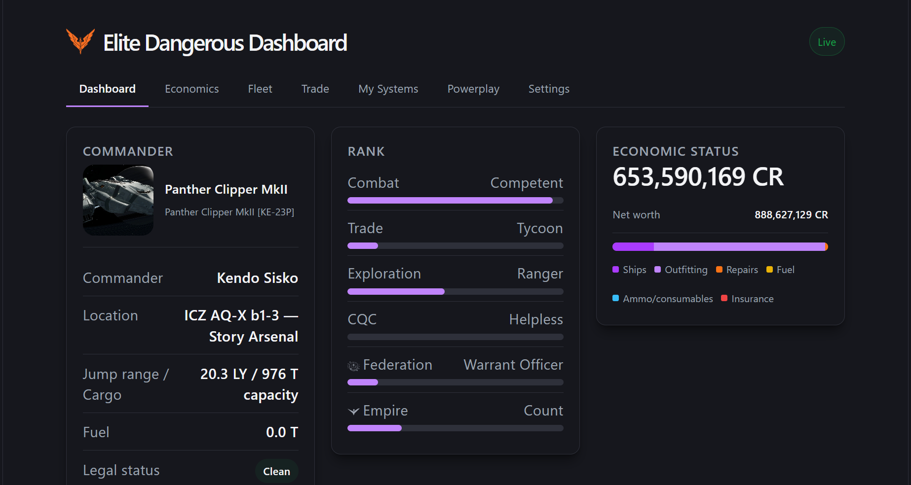
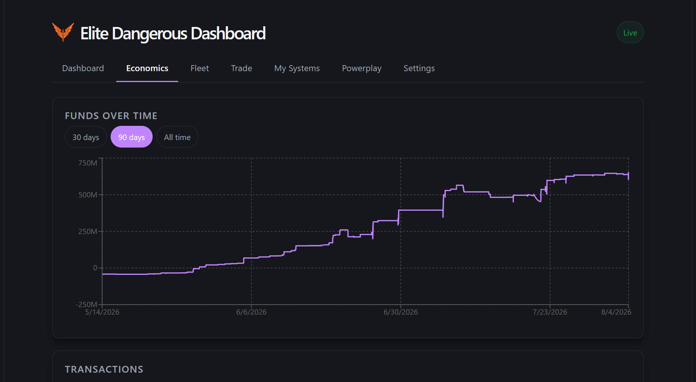
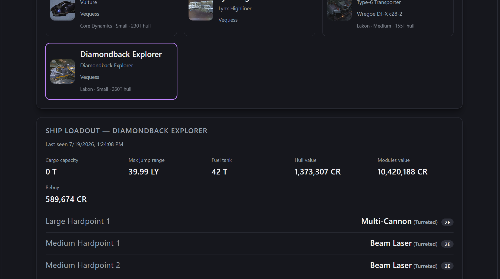
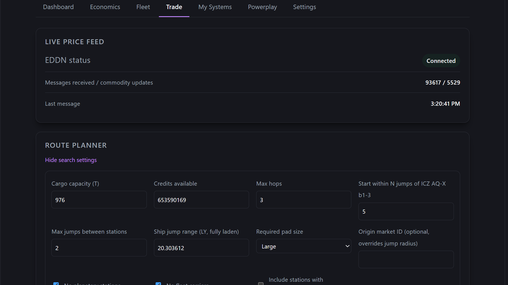
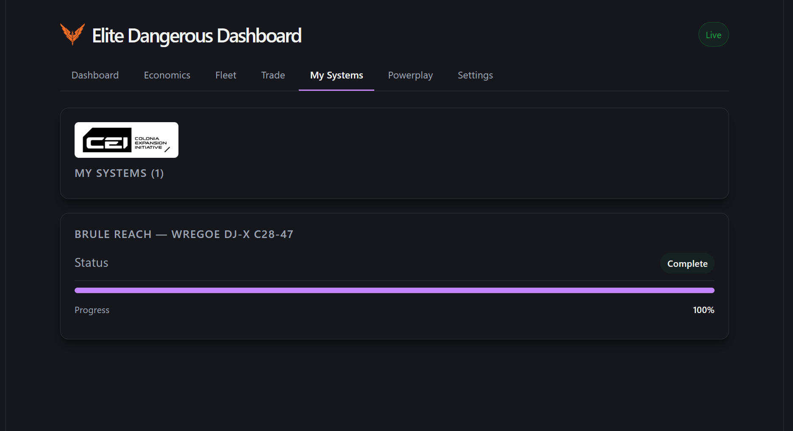
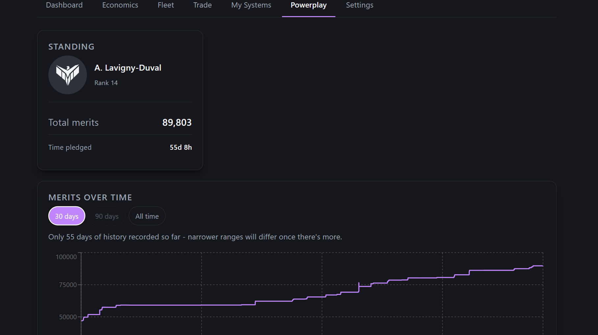
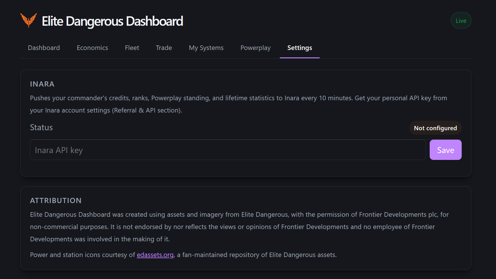

# User guide

How to use each tab of the Elite Dangerous Dashboard. For install and security limits (one commander, private LAN only), see the [README](../README.md).

Screenshots live in [`images/user-guide/`](images/user-guide/). If an image is missing below, drop the matching PNG into that folder using the filename shown — nothing else in this guide needs to change.

## Opening the dashboard

With the tray app running, open `http://localhost:5080` on the gaming PC, or use the tray menu’s **Open dashboard** / QR code for another device on your LAN.

The header shows a **Live** badge when the browser is connected to the Host over SignalR. If it says **Connecting…**, the Host isn’t reachable yet (still starting, wrong URL, or firewall).

---

## Dashboard

*Filename: `dashboard.png`*

Your at-a-glance overview while playing. Everything here updates live as journal / status events arrive — no refresh needed.

| Card | What it shows |
|------|----------------|
| **Commander** | Current ship portrait, commander name, system/station, jump range and cargo capacity, main fuel tank, and legal status (Clean / caution / wanted). |
| **Rank** | Combat, Trade, Exploration, CQC, Federation, and Empire ranks with progress bars toward the next tier. |
| **Economic status** | Current credits and net worth, plus a colour spend breakdown (ships, outfitting, repairs, fuel, ammo, insurance) when those totals exist. |
| **Fleet** | Short list of owned ships and where each one is (active ship marked). For the full picture, use the **Fleet** tab. |
| **Trade route** | Summary of an active trade plan (hops done, estimated profit, next hop). Start or abandon routes on the **Trade** tab. |

---

## Economics

*Filename: `economics.png`*

Credit history derived from journal transactions (plus your live balance as the “now” anchor).

- **Funds over time** — line chart of balance. Use **30 days / 90 days / All time** to change the window; your choice is remembered in the browser. If you don’t have much history yet, narrower ranges may look the same as All time until more data accumulates.
- **Transactions** — income vs expense summary for the listed feed, then each recorded transaction with category, description, time, and amount.

Not every credit movement in the game is captured yet; the chart is built from the categories the app knows how to record.

---

## Fleet

*Filename: `fleet.png` — capture with a ship selected so the loadout panel is visible.*

- **Fleet grid** — every owned ship as a card (portrait, type, location, manufacturer / size / hull mass when known). The ship you’re flying shows an **active** chip. Click a card to select it.
- **Ship loadout** — for the selected ship: last time a loadout was seen, cargo capacity, max jump range, fuel tank, hull/modules value, rebuy, then each module with readable slot names, class/rating, and engineering where present. Loadouts are stored when you **board** that ship in-game; a stored hull you’ve never boarded here will say no loadout is recorded yet.
- **Wishlist** — free-form list of ships you want (type, optional display name, optional estimated cost). **Bought it** marks an item purchased; **Remove** deletes it.

Ship portraits use your images under `%LOCALAPPDATA%\EliteDashboard\ship-art\` when present; otherwise a generated placeholder. See [Custom ship art](../README.md#custom-ship-art) in the README.

---

## Trade

*Filename: `trade.png` — preferably with Search settings expanded.*

Route finding against live market prices from the EDDN feed.

- **Live price feed** — whether the EDDN listener is connected, and rough message counts.
- **Search settings** (toggle) — cargo, credits, max hops, jump radii, laden jump range, required pad size, optional origin market ID, and filters for planetary stations / fleet carriers / unknown pad size. Values default from your current ship and location; **edits you make stick** across navigation and restarts until you click **Reset to detected ship/location defaults**. Distances are straight-line, not plotted routes.
- **Find routes** — runs a search and lists candidates (commodity, buy/sell stations, profit).
- **Activate this route** — promotes the current search result set into the **Active trade route** (tracked hops: pending / in transit / done). Progress also appears on the Dashboard.
- **Abandon route** — clears the active plan.

Prices older than a few days are ignored so stale quotes don’t drive routes.

---

## My Systems

*Filename: `systems.png`*

Colonisation construction sites you’re building or actively contributing to.

A site appears after you’ve delivered at least one load of cargo there, or claimed the system as architect — merely docking at someone else’s project does not add it.

For each site you’ll see status (in progress / complete / failed), a progress bar, remaining resources (with an optional shipping plan), and a summary of **your deliveries** (total tonnage and drop count; expand to see each drop).

---

## Powerplay

*Filename: `powerplay.png`*

If you’re pledged to a power: standing (power, rank, total merits, time pledged) and a **Merits over time** chart with the same 30 / 90 / All time range buttons as Economics. If you’re not pledged, the tab says so.

---

## Settings

*Filename: `settings.png`*

- **Inara** — optional sync of credits, ranks, Powerplay standing, and lifetime statistics about every 10 minutes. Paste your personal API key from Inara (account → Referral & API). Status shows whether a key is configured and the last sync result. **Remove key** stops syncing. The key is stored only in your local database and is never shown back in the UI after save.
- **Attribution** — Frontier / edassets credits for the project.

---

## Tips

- **After republishing the app**, hard-refresh the browser (Ctrl+Shift+R) — the PWA can keep an old app shell until you do.
- **Phone on the LAN** — run `deploy/install.ps1` once (Admin) for the Private-profile firewall rule; use the tray QR for the exact URL.
- **Do not expose port 5080 to the internet** — see [Who this is for](../README.md#who-this-is-for-read-this) in the README.

## Screenshot checklist

Save these under `docs/images/user-guide/` (browser ~1200px wide is enough):

| File | Capture |
|------|---------|
| `dashboard.png` | Dashboard tab |
| `economics.png` | Economics tab |
| `fleet.png` | Fleet with a ship selected (loadout visible) |
| `trade.png` | Trade, ideally with search settings open |
| `systems.png` | My Systems |
| `powerplay.png` | Powerplay |
| `settings.png` | Settings |
